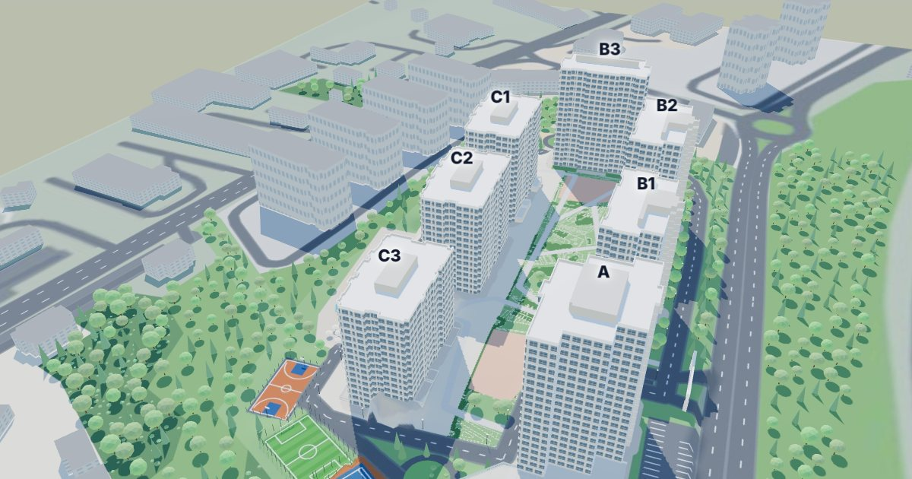

# 5. Levent Korupark · 3B site modeli

İstanbul 5. Levent'teki Korupark sitesinin tarayıcıda çalışan etkileşimli 3B modeli.
**Canlı:** <https://korupark.5-levent.com/3d>

Komşuların siteyi incelemesi için hazırlanmış bir hobi projesidir; GYO ya da site yönetimi ile bağlantısı yoktur.



## Neler var

- 7 blok, 744 daire; her daire seçilebilir. Seçilen dairenin katı, cephesi, alanı, arsa payı ve tipi görünür.
- **Kat planı:** seçili katın üstü kesilir, Yönetim Planı paftasındaki iç plan zemine serilir, taşıyıcı duvarlar 3B çıkar;
  asansör yeşil, yangın merdiveni kırmızı.
- **Otopark:** dairenin otopark yerleri kendi kot renginde, krokideki hücrenin yönünde araçla gösterilir; "otoparka nasıl gidilir" tarifi.
- Havuz, spor sahaları, oyun alanları, ağaçlar, site içi yol, komşu binalar ve çevre yolları.
- Telefona uyumlu; bağlantı `/3d#C3-88` gibi daireyi seçili açar.

## Çalıştırma

Derleme aracı yok; tek HTML + three.js (r160).

```bash
python3 araclar/site-3b/sunucu.py        # http://127.0.0.1:3042/3d
```

## Yeniden üretme

```bash
/usr/bin/python3 araclar/site-3b/uret.py # numpy, scipy, opencv-python, Pillow gerekir
```

`uret.py` girdileri `data/` altındadır (blok/kat/daire listesi, Yönetim Planı Ek-3/Ek-4/Ek-6 verisi, otopark veritabanı) ve
`public/assets/krokiler/` (Ek-3 otopark krokileri). Daire iç plan dokuları Yönetim Planı ekler PDF'inden üretilir; PDF bu depoda
yoktur, `data/yonetim-plani/` altına konursa yeniden üretilir, yoksa hazır dokular kullanılır.
Yöntem, hizalama ve varsayımlar: [`araclar/site-3b/BENIOKU.md`](araclar/site-3b/BENIOKU.md).

## Sınırlar

Model belgelerden çıkarılmıştır; ölçülmüş rölöve değildir. Kotlar, arazi eğimi, peyzaj ve spor sahalarının yüksekliği yaklaşıktır.
A blok zemin kotu paftada yazmadığı için B1 ile aynı (+61,15) varsayılmıştır. İç plan her katta normal kat paftasından gösterilir.

## Lisans

- **Kod** (`araclar/`, `public/site-3b.html`): [MIT](LICENSE)
- **Veri** (`public/assets/site-3b/model.json`, `araclar/site-3b/kaynak/osm.json`): OpenStreetMap verisinden türetildiği için
  [ODbL 1.0](LICENSE-VERI.md) — © OpenStreetMap katkıcıları.
- **Yönetim Planı paftaları** (kat planları, otopark krokileri, vaziyet planı görüntüleri): tapuya şerh edilmiş yönetim planının
  ekleridir; bilgi amacıyla yer alır, bu depo onlar üzerinde hak iddia etmez.
- three.js © three.js yazarları, MIT.

İletişim: mail@5-levent.com
